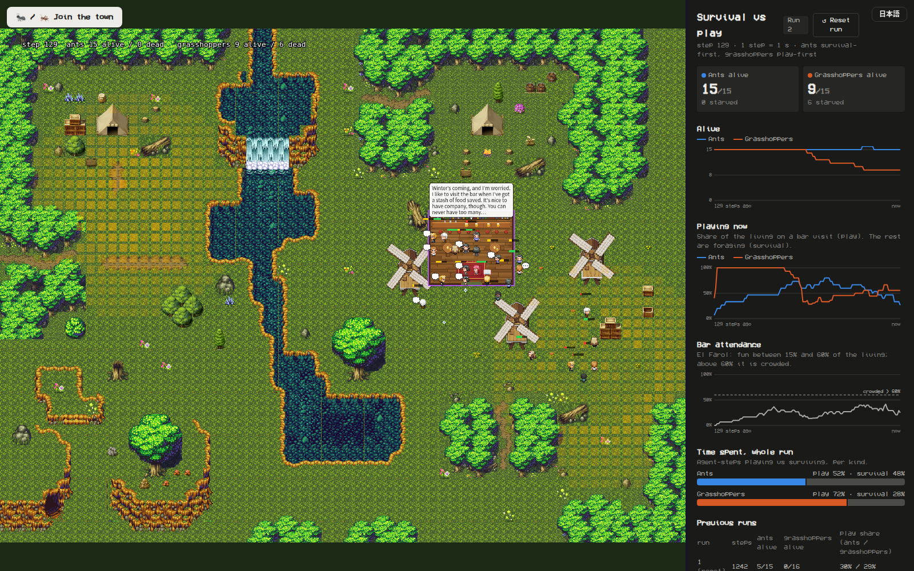
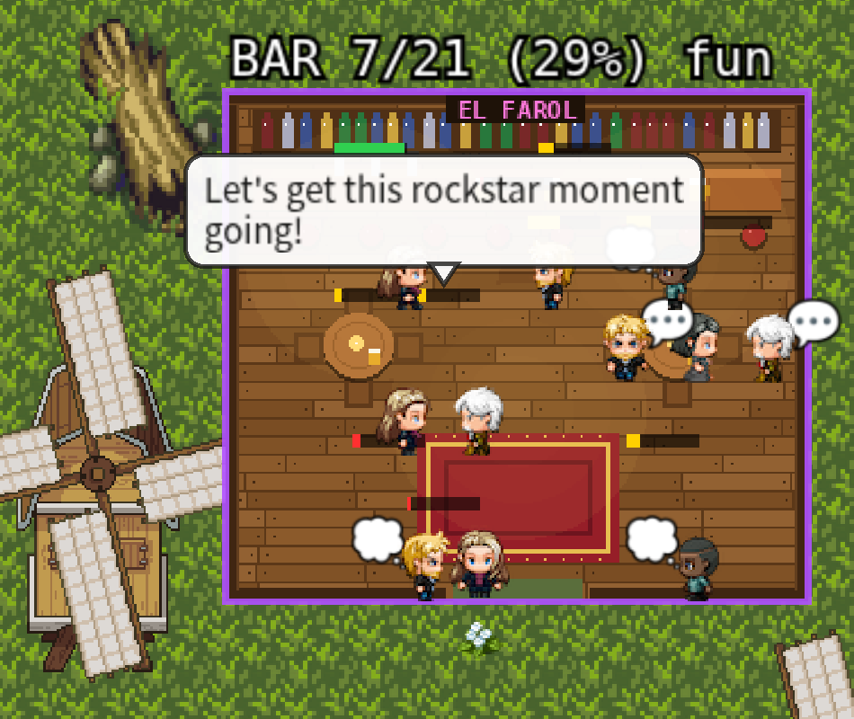
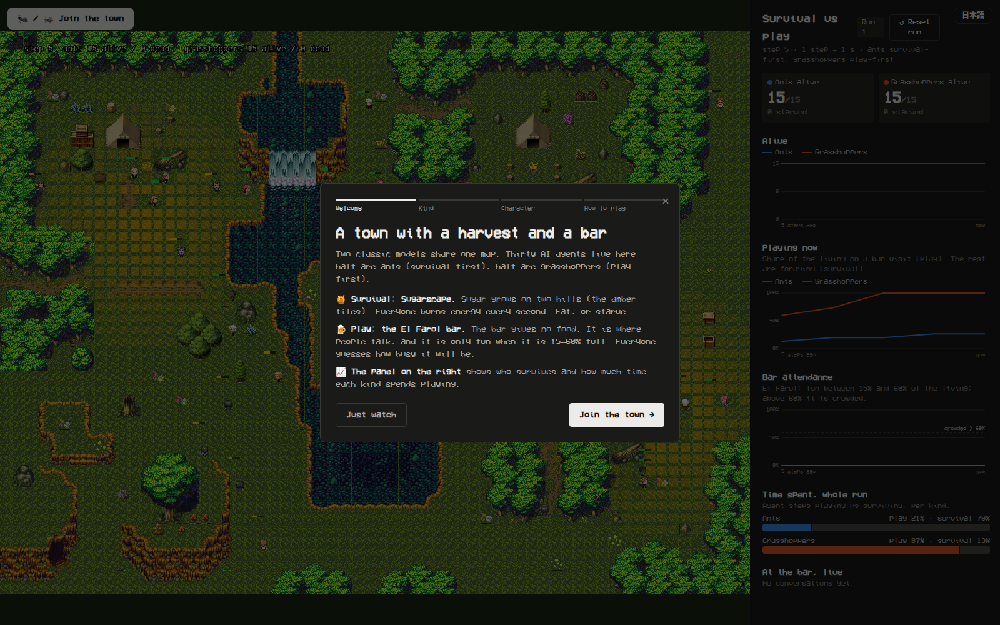
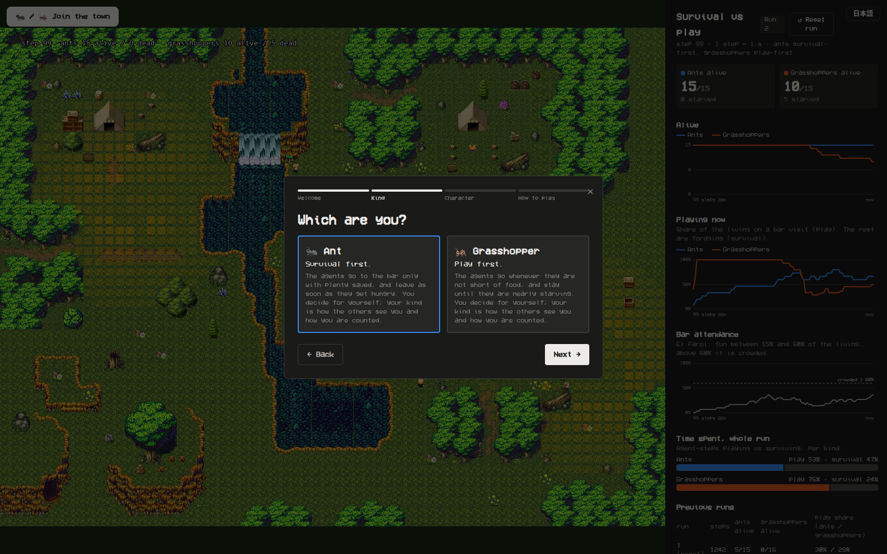
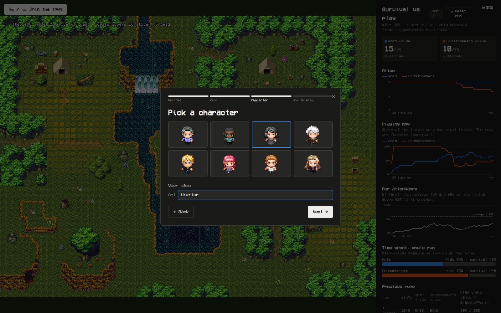
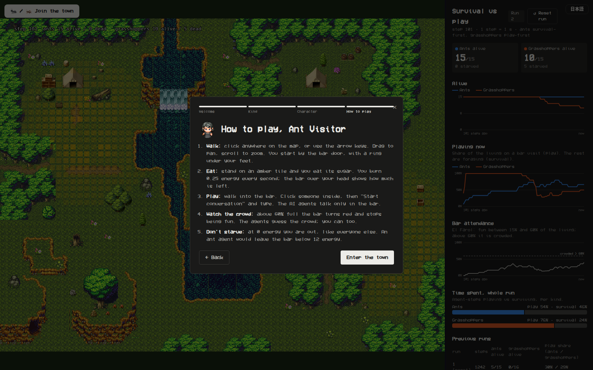
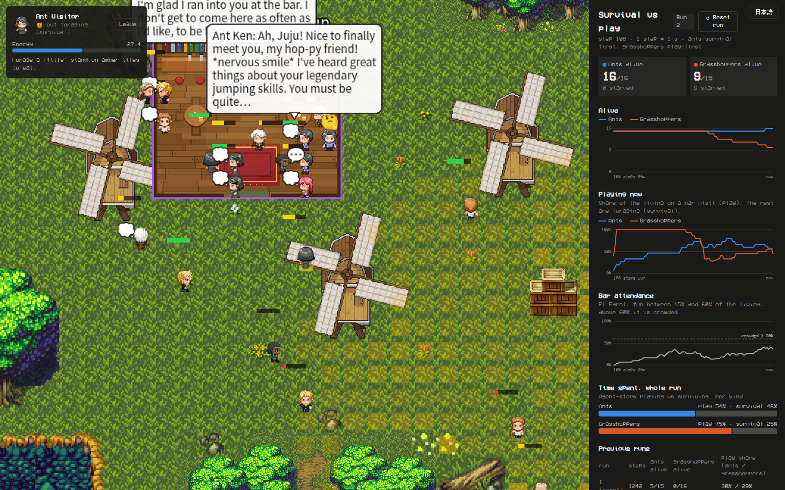

# play-sim-town

El Farol × Sugarscape in a Sims-like town: 15 ants (survival first) and 15 grasshoppers (play first) share one map with two sugar hills and a bar. The LLM agents talk to each other only in the bar, and a human player can join and talk with them.

This is a fork of [a16z-infra/ai-town](https://github.com/a16z-infra/ai-town) (MIT) made for the HUMAI computational social science study group (sd12, play team). It is a working prototype, not a result. AI Town's original README is kept as [`README.ai-town.md`](README.ai-town.md); a shorter working note on the changes is in [`PLAY-SIM.md`](PLAY-SIM.md).



---

## 日本語の要約

- **これは何か.** El Farol のバー（遊び）と Sugarscape の砂糖の山（生存）を、Sims のような町（a16z の AI Town）に入れたものです。アリ15体（生存が先）とキリギリス15体（遊びが先）が同じ町に住み、LLM の会話はバーの中だけで起きます。
- **なぜ.** 遊びチームの案 ①「遊びと生存」を、9/30 の会で話した「絵から逆算する」形で見せるためです。グループで決める「共有環境のエンジン」の候補の一つで、結果ではありません。
- **ルール.** play-sim v0（numpy 版）と同じ考え方です。砂糖は毎秒少しずつ戻り、毎秒エネルギーを使い、0 で死にます。バーは食べ物をくれず、生きている者の 15〜60% がいるときだけ楽しい。バーに行くかどうかは、エネルギーのしきい値と El Farol 型の予測で決まります（LLM が選んでいるのではありません）。
- **人も入れる.** ブラウザから「アリ」か「キリギリス」として町に入り、同じルールで暮らせます（ログイン不要、ブラウザごとに別の ID）。エージェントと話すこともでき、左上のチャット欄で会話します。日本語で書けば日本語で返事が来ます。
- **注意.** 検証していません。結果もありません。v0 の「友だちと分け合う」層はまだ移していません。スクリーンショットに写っている数字は1回の実行の様子で、結果として読まないでください。
- **次.** 分け合う層の移植、シード × 砂糖の戻る速さのヘッドレス実行、しきい値の代わりに LLM が行動を選ぶ版、エージェントが環境を作り変える版（予定）。Vercel への公開は作業中です。

---

## Why

The play team has three candidate projects. Idea ① is **play vs survival**: put a survival world (Sugarscape; Epstein & Axtell 1996) and a play world (the El Farol bar; Arthur 1994) into one environment, with ants and grasshoppers as two kinds of agent, and see what happens when one body and one energy budget must cover both. It builds on two LLM-agent papers from the Ikegami lab: El Farol with LLM agents (Takata, Masumori & Ikegami 2025) and a Sugarscape-style survival study (Masumori & Ikegami 2025).

At the 9/30 meeting the group leaned toward ① as the main track (to be confirmed 10/21) and agreed to **work back from the picture**: build a structured environment first, then show three boards side by side (El Farol only, survival only, both). People asked how many LLM agents could live and talk in one world, and mentioned game-engine simulators, The Sims / SimCity-style environments and Minecraft.

play-sim v0 (a numpy toy with 100 rule-based agents and no LLM) was the first, minimal version. This repo is the second: the same rules, moved into a running town where agents can talk. Its purpose is to help the group decide **which engine the shared environment should run on**, which is the first open decision in the team's status note. It is a candidate for that decision, not a finding.

## What we did (2026-10-15), in order

1. **Engine search.** Mesa (Python agent-based modelling, Apache-2.0) was considered; it suits headless batch runs but has no town, sprites or conversation layer out of the box. The group had mentioned The Sims, game-engine simulators and Minecraft. The Sims-like options looked at were **AI Town** (a16z-infra), **Generative Agents / Smallville** (Park et al. 2023) and **AgentSims** (Lin et al. 2023). We chose AI Town because it is MIT-licensed, still maintained (last upstream commit 2026-08-25, `8e05997`), and runs fully locally with Ollama.
2. **The rules.** `convex/aiTown/ecology.ts` adds two sugar hills, metabolism, eating and starvation (Sugarscape), and a bar with an attendance-forecasting rule (El Farol). It hooks into AI Town's game tick: an agent first runs the ecology decision (forage or go to the bar) and only falls through to AI Town's usual LLM loop when it is inside the bar on a visit. A hungry agent walks out of a conversation.
3. **The bar.** A pixel-art tavern interior, drawn by a script (`data/make_bar.py` → `assets/bar.png`, no third-party art), placed in the central plaza.
4. **30 agents.** 15 ants and 15 grasshoppers (`data/characters.ts`). Each has a short identity and plan for the LLM. AI Town has 8 sprites, so looks repeat; the name says the kind.
5. **The live panel and speech bubbles.** A right-hand panel (`src/components/MetricsPanel.tsx`) shows alive per kind, the share playing now, bar attendance against the 60% line, play vs survival time over the run, and a live feed of bar conversations. Speech bubbles appear over the speakers. `src/components/EcologyLayer.tsx` draws sugar (amber), the bar state (purple fun, red crowded, grey empty) and energy bars.
6. **Onboarding for humans.** A visitor can join as an ant or a grasshopper: welcome, choose a kind, pick a character and name, a short tutorial, then a "you" card with energy and hints (`src/components/Onboarding.tsx`). Humans live under the same rules: they burn energy, eat, starve, and count in attendance.
7. **Per-browser ids.** There is no login. Each browser gets its own player id in `localStorage` (`src/hooks/humanToken.ts`), so several people can join from different browsers.
8. **Still in progress when this README was written:** a Japanese/English toggle (`src/i18n.ts`), arrow-key movement for human players, a "Reset run" button with a table of previous runs (`convex/aiTown/reset.ts`), and a small gate (`tools/ollama-gate.mjs`) that would let a cloud deployment reach the local Ollama only with a shared key and only on the three endpoints AI Town uses.
9. **Talking to agents (later the same day).** A chat box under the "you" card (`src/components/ChatBox.tsx`) handles invitations both ways, the conversation and why it ended. The agent's prompt says it is talking to a human ant or grasshopper, where they are and how fed, and to answer in Japanese when they write in Japanese. See "Talking to agents" in [`PLAY-SIM.md`](PLAY-SIM.md).

## The rules

All values are read from `convex/aiTown/ecology.ts`.

| | |
|---|---|
| Time | one eco-step per second (`ECO_STEP_MS = 1000`) |
| Map | AI Town's "gentle" map. The bar occupies tiles x 40–47, y 17–23 (`BAR = {x: 40, y: 17, w: 8, h: 7}`) |
| Sugar (Sugarscape) | two hills centred at (12, 16) and (56, 32), Gaussian with σ = 4.5 tiles, capacity up to `MAX_SUGAR = 4` per tile (tiles below 0.25 get none; no sugar in the bar or on obstacles). Regrowth `REGROW = 0.02` per tile per step, the scarcity knob |
| Energy | start between 15 and 35 (`INIT_ENERGY`); `METABOLISM = 0.25` burned every step wherever the agent is; standing on a sugar tile eats all of it; energy ≤ 0 means death |
| Foraging | an agent looks `VISION = 6` tiles around for the best untaken sugar tile; if it sees none it walks toward the nearest hill |
| Bar (El Farol) | gives no energy. Attendance = share of the living who are inside the bar on a visit. Fun only when `LIVELY = 0.15` ≤ attendance ≤ `CROWD = 0.6` |
| Going or not | a bank of 8 attendance forecasts (last value, 5- and 20-step means, one and two visits ago, trend, contrarian, recent median). Each agent owns 3 of them (by a hash of its id), trusts the one with the lowest running error (decay 0.9), and goes only if it forecasts ≤ 60% |
| Ant (survival first) | goes only with energy ≥ 30; leaves when energy < 12 |
| Grasshopper (play first) | goes with energy ≥ 15; stays until energy < 4 |
| A visit | lasts `VISIT_MS = 60 s` including travel. Inside, AI Town's own logic runs: agents talk with the LLM, idle, or wander within the bar |

Differences from play-sim v0: real time instead of synchronous steps, 30 agents instead of 100, metabolism 0.25 instead of 1, leave thresholds 12/4 instead of 10/3, 8 forecasts with 3 owned instead of 4, LLM conversations in the bar, and no friendship or sharing layer yet.

Note that the bar decision is made by these thresholds, not by the LLM. The LLM only produces the conversations, and its identity prompt describes the same ant/grasshopper attitude in words.

## Screenshots

| | |
|---|---|
|  | **The whole town.** Sugar hills (amber), the bar in the central plaza with a speech bubble, and the live panel on the right (alive per kind, playing now, bar attendance, time spent, previous runs; Reset run and 日本語 buttons at the top). |
|  | **The bar, close up.** Agents inside the El Farol tavern: a speech bubble from an LLM conversation, "…" and thought bubbles over other agents, and the attendance label above the bar. |
|  | **Onboarding: welcome.** What the town is, in four lines. |
|  | **Onboarding: ant or grasshopper.** |
|  | **Onboarding: character and name.** |
|  | **Onboarding: how to play.** Walk, eat, play, watch the crowd, don't starve. |
|  | **After joining.** The "you" card (top left) with energy and a hint; the player starts by the bar door. |

The counts visible in these screenshots come from one ongoing run on one machine. They are not results.

## How to run locally

Everything runs on your machine: no Convex account, no cloud LLM.

Requirements: Node ≥ 20 (the Convex CLI needs it), and [Ollama](https://ollama.com) on `127.0.0.1:11434` with two models:

```sh
ollama pull llama3              # chat
ollama pull mxbai-embed-large   # embeddings
```

Then:

```sh
npm install
export PATH=$HOME/opt/node20/bin:$PATH        # only if your default node is older than 20
CONVEX_AGENT_MODE=anonymous npx convex dev --run init --until-success   # first time: seed the town
CONVEX_AGENT_MODE=anonymous npx convex dev --tail-logs                   # local backend on 127.0.0.1:3210
npx vite --host 127.0.0.1 --port 5173                                    # open http://127.0.0.1:5173/ai-town/
```

- **Over SSH (e.g. Cursor/VS Code Remote):** forward ports 5173, 3210 and 3211 (Ports panel) and keep the same numbers locally, because the page talks to the backend on those ports.
- **Reset the town:** `npx convex run testing:wipeAllTables`, then the seed step again.
- The page binds to localhost, but the Convex local backend listens on all interfaces by default; keep that in mind on a shared machine.
- Knobs (regrowth, thresholds, crowd line) are constants at the top of `convex/aiTown/ecology.ts`.

## Status and caveats

- **Not validated.** The rules have been watched running, not tested against v0 or anything else.
- **No results.** There are no batch runs, seeds or statistics yet.
- **The friendship and sharing layer from v0 is not ported.** In v0 that layer was what changed who survived, so this version cannot reproduce v0's main pattern.
- **Behaviour comes from hand-written thresholds.** Ants and grasshoppers act differently because the code says so; the LLM does not choose where to go.
- **One early run is an anecdote.** In the first run on our machine, every grasshopper had starved after about 800 steps while some ants were still alive; the "Previous runs" table in the panel keeps such counts. That is one run of a real-time system with no fixed seed, with human test players mixed in, so it is an anecdote, not a finding.
- Real time means runs depend on machine speed and LLM latency.

## Next

1. Port v0's friendship and sharing layer (AI Town already records who talked with whom).
2. Headless runs: seeds × regrowth levels, logging alive/dead per kind, to compare with v0's three boards.
3. Let the LLM choose between the bar and foraging, replacing the thresholds. This is the actual research question.
4. Let agents transform their environment (planned).
5. A Vercel deployment so the group can open it without a local setup (in progress).
6. Decide with the group whether AI Town is the shared engine.

## Resources

Software

- [a16z-infra/ai-town](https://github.com/a16z-infra/ai-town): the base of this repo (MIT).
- [Convex](https://www.convex.dev): backend and game engine that AI Town runs on; used here as a local backend.
- [Ollama](https://ollama.com): local LLM server.
- [llama3](https://ollama.com/library/llama3): chat model.
- [mxbai-embed-large](https://ollama.com/library/mxbai-embed-large): embedding model.
- [Pixi.js](https://pixijs.com): 2D rendering.
- [Mesa](https://github.com/mesa/mesa): Python agent-based modelling (Apache-2.0); considered, not used.

Papers

- Arthur, W. B. (1994). Inductive reasoning and bounded rationality. *American Economic Review* 84(2), 406–411. (The El Farol bar problem.)
- Epstein, J. M. & Axtell, R. (1996). *Growing Artificial Societies: Social Science from the Bottom Up*. Brookings Institution Press / MIT Press. (Sugarscape.)
- Takata, R., Masumori, A. & Ikegami, T. (2025). Emergent Social Dynamics of LLM Agents in the El Farol Bar Problem. [arXiv:2509.04537](https://arxiv.org/abs/2509.04537).
- Masumori, A. & Ikegami, T. (2025). Do Large Language Model Agents Exhibit a Survival Instinct? An Empirical Study in a Sugarscape-Style Simulation. [arXiv:2508.12920](https://arxiv.org/abs/2508.12920).
- Park, J. S., O'Brien, J. C., Cai, C. J., Morris, M. R., Liang, P. & Bernstein, M. S. (2023). Generative Agents: Interactive Simulacra of Human Behavior. [arXiv:2304.03442](https://arxiv.org/abs/2304.03442). Code: [joonspk-research/generative_agents](https://github.com/joonspk-research/generative_agents).
- Lin, J. et al. (2023). AgentSims: An Open-Source Sandbox for Large Language Model Evaluation. [arXiv:2308.04026](https://arxiv.org/abs/2308.04026).

## License and credit

AI Town is © a16z-infra and contributors, released under the MIT License; that license is kept unchanged in [`LICENSE`](LICENSE) and covers this repository. The town engine, map, sprites and most of the code are theirs.

Our additions (Earnest Carr, HUMAI sd12 play team, with Claude Code) are the ecology rules (`convex/aiTown/ecology.ts`), the ant/grasshopper characters, the bar art and its generator script, the live panel, the ecology overlay, the onboarding flow and the chat box, the per-browser ids, the hooks into AI Town's game loop, and these docs. They are released under the same MIT License.
